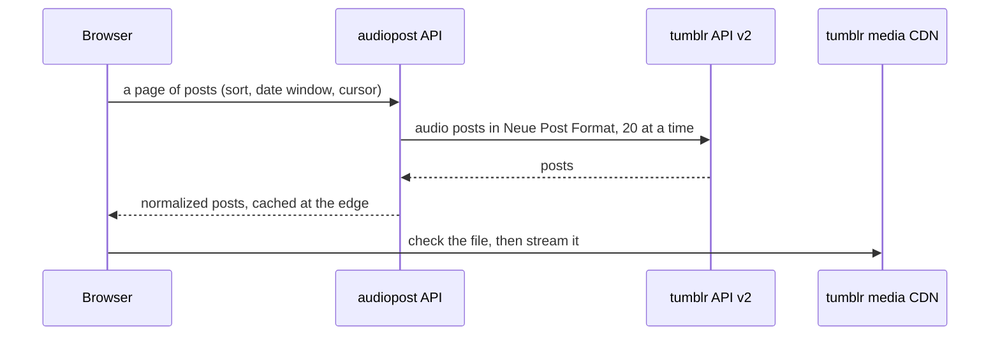

<p align="center">
  <a href="https://audiopost.online">
    <picture>
      <source media="(prefers-color-scheme: dark)" srcset="assets/logo/svg/audiopost-lockup-on-dark.svg">
      
    </picture>
  </a>
</p>

<p align="center"><strong>Browse and play any tumblr blog's audio posts.</strong></p>

<p align="center">
  <a href="https://github.com/cwfreelance/audiopost/actions/workflows/ci.yml"></a>
  <a href="LICENSE"></a>
  <a href="https://pnpm.io"></a>
</p>

<p align="center"><a href="https://audiopost.online">audiopost.online</a></p>

---

Type a tumblr username and get a scrollable list of that blog's audio posts, with a built-in player. Free, open source, no sign-up.

audiopost is inspired by [topherchris](https://topherchris.com/about)'s Tumblr Audio Parser, which went offline years ago.

## Features

- **Any public blog.** Every audio post a blog has made, newest or oldest first, narrowed to a year or a month. The URL holds the view, so a filtered list can be bookmarked or shared.
- **A real player.** Songs uploaded to tumblr play in the audiopost player, one after another, with a seek bar and previous/next. Lock-screen, headphone, and keyboard media keys drive the same queue.
- **Embeds where they live.** SoundCloud, Spotify, and Bandcamp posts play inside their post, in that site's own player. The audiopost player pauses so two things never play at once.
- **Old files, handled.** tumblr's CDN can take a while to serve a file nobody has played in years. audiopost checks each file before playing it, waits and retries while it wakes up, and says plainly when a file has been deleted or its old host is gone.
- **Light and dark.** The site follows your system setting, and respects "reduce motion".

## How it works



- The API route is the only code that talks to tumblr, so the API key never reaches the browser. It normalizes tumblr's Neue Post Format into one shape for native tracks, embeds, and links. [ADR 0001](docs/adr/0001-tumblr-npf-format.md) records why NPF and not the legacy format.
- Responses are cached at the edge: a blog's first page for 5 minutes, later pages for a day, since older posts don't change. That keeps repeat visits well inside tumblr's rate limits.
- Audio streams straight from tumblr's CDN to the browser. One shared `<audio>` element plays every track, which is what lets iOS move to the next track with the screen locked.

## Built with

[Next.js](https://nextjs.org) 16 (App Router, Cache Components) and React 19, in TypeScript. Tested with [Vitest](https://vitest.dev) and [Playwright](https://playwright.dev), and deployed on [Vercel](https://vercel.com). [DOMPurify](https://github.com/cure53/DOMPurify) cleans post captions before they render.

## Local development

Requires Node.js 24 and [pnpm](https://pnpm.io).

1. Install dependencies:

   ```sh
   pnpm install
   ```

2. Register an app at [tumblr.com/oauth/apps](https://www.tumblr.com/oauth/apps), then create `.env.local` at the repo root with its OAuth consumer key:

   ```sh
   TUMBLR_API_KEY=<your consumer key>
   ```

3. Start the dev server and open [localhost:3000](http://localhost:3000):

   ```sh
   pnpm run dev
   ```

| Script | What it does |
|---|---|
| `pnpm run dev` | Dev server |
| `pnpm run build` / `pnpm start` | Production build and server |
| `pnpm run typecheck` | TypeScript |
| `pnpm run lint` | ESLint |
| `pnpm test` | Vitest unit and integration tests |
| `pnpm run test:e2e` | Playwright end-to-end tests (run `pnpm exec playwright install chromium` once first) |

CI runs typecheck, lint, and both test suites on every pull request.

## Project layout

```text
app/
├── page.tsx              landing page
├── [username]/           a blog's posts, cards, filters, and the player bar
└── api/blogs/[username]/ the posts API, the only code that calls tumblr
lib/                      pure logic: post normalizing, the play queue, views, usernames
e2e/                      Playwright smoke test
fixtures/tumblr/          recorded tumblr responses the tests replay
assets/logo/              the logo, its fonts, and brand colors
docs/adr/                 architecture decision records
```

## Contributing

Bug reports, ideas, and pull requests are welcome. See [CONTRIBUTING.md](CONTRIBUTING.md) for how to get set up and what makes a pull request easy to merge.

Found a bug? [Open an issue](https://github.com/cwfreelance/audiopost/issues/new). If audiopost showed an error code, include it.

## Credits

- [topherchris](https://topherchris.com/about), for the original Tumblr Audio Parser.
- The wordmark is set in [Londrina Solid](https://fonts.google.com/specimen/Londrina+Solid) under the [SIL Open Font License](assets/logo/fonts/OFL.txt). The site uses [Special Elite](https://fonts.google.com/specimen/Special+Elite) and [SN Pro](https://fonts.google.com/specimen/SN+Pro).

This application uses the tumblr application programming interface but is not endorsed or certified by tumblr, Inc.

## License

[MIT](LICENSE)
